<div align="center">

<picture>
  <source media="(prefers-color-scheme: dark)" srcset="docs/readme/logo-white.png">
  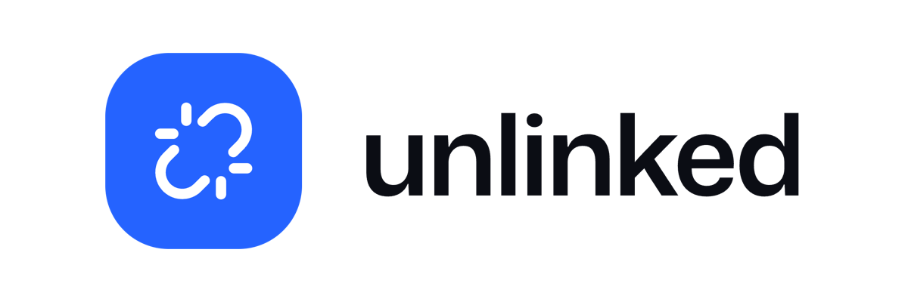
</picture>

### Private payment links on Bitcoin Cash

Share one link. Get paid in BCH or any token. Every payment lands on a fresh address only you can find, then moves into a zero-knowledge pool that BCH Script verifies on mainnet.

[](https://getunlinked.pages.dev)
[](https://getunlinked.pages.dev/demo.mp4)
[](#live-on-bch-mainnet)
[](shield/contracts/ShieldPool.scash)
[](shield/circuits/transact.circom)

[Live app](https://getunlinked.pages.dev) &nbsp;&nbsp; [Demo video](https://getunlinked.pages.dev/demo.mp4) &nbsp;&nbsp; [Pitch deck](https://getunlinked.pages.dev/deck.pdf)

<br>

<a href="https://getunlinked.pages.dev/demo.mp4">
  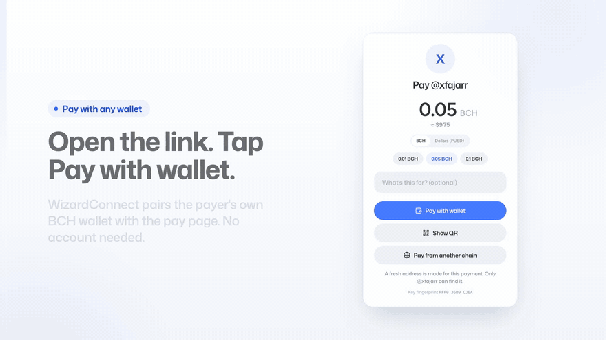
</a>

<sub>A real WizardConnect payment on mainnet. Click for the full narrated demo (1 min 34 s), every transaction in it is real.</sub>

</div>

<br>

Built for BCH BLAZE 2026.

- The payer can't see where your money goes next.
- You can't see the payer's wallet when they pay from a shielded balance.
- Our server never learns who got paid. It stores public keys and handle-less announcements, nothing else.

## The problem

To get paid in BCH today, you post an address. Anyone who has it can look up every payment you received, add up your income, and watch where you send the money next. Every client who pays you sees all of that too. For a freelancer, a creator taking tips or a small shop, sharing one payment address means publishing their books.

Unlinked gives you one link, like `getunlinked.pages.dev/@xfajarr`. People pay through it with a BCH wallet, a QR code, or a token from another chain. Each payment lands on a new address that only you can find, and the app then moves it into Unlinked Shield, a zero-knowledge pool we wrote for this hackathon. On chain, your payments don't point to you or to each other.

<p align="center">
  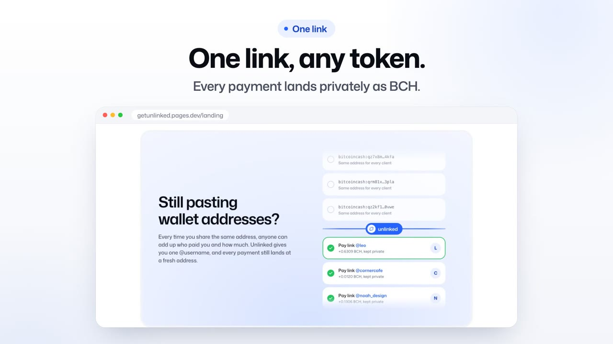
</p>

## How it works

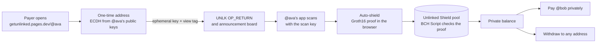

1. You claim a handle. The app creates your keys in the browser, locks them with a PIN and gives you a 12-word backup. Our server keeps your handle and public keys. It never sees your private keys and never learns who paid you.
2. A payer opens your link. Their browser derives a one-time address from your public keys with ECDH on secp256k1 (the same idea as ERC-5564 stealth addresses) and pays it. The only extra data it publishes is an ephemeral public key and a one-byte view tag, on our announcement board and, when the page builds the transaction (WizardConnect), in an `UNLK` OP_RETURN. Neither one contains your handle.
3. Your app scans those announcements with your scan key, picks out the payments meant for you, and can spend them with your spend key.
4. By default the app then shields each payment. It builds a Groth16 proof in a Web Worker and deposits into the pool, and BCH Script checks the proof on mainnet. From the private balance you can pay another `@handle` or withdraw to any BCH address. A private transfer hides sender, receiver and amount, and a withdraw doesn't show which deposit the coins came from.

## Ways to pay

- Any BCH wallet through WizardConnect. We tested it on mainnet with Cashonize.
- A QR code for any BCH wallet.
- USDC, USDT, ETH, SOL and other tokens through NEAR Intents. The swap pays BCH straight to the one-time address, so a cross-chain payment gets the same treatment as a BCH one.

In the app you get one balance in USD, split into private (in the pool) and arriving (landed, not shielded yet). Auto-shield is on by default, with a switch in Settings. The wallet has a PIN lock with an auto-lock timer you pick. The pay page saves its step, so a payer who refreshes during a cross-chain deposit comes back to the same screen.

## Stablecoin bridge

[getunlinked.pages.dev/bridge](https://getunlinked.pages.dev/bridge) moves stablecoins and other tokens between 36 chains and Bitcoin Cash, in both directions, with no account. The token picker lists every chain and token the app supports through NEAR Intents. On the BCH side you can pick PUSD (ParyonUSD), MUSD (Moria USD) or plain BCH. NEAR Intents moves the stablecoin to or from BCH, and Cauldron DEX pools swap BCH and the BCH stablecoin.

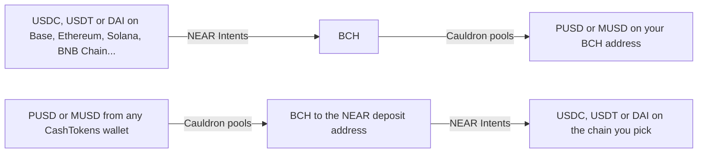

- Into BCH: pick a stablecoin and chain and send it to the NEAR deposit address. For PUSD or MUSD, NEAR delivers BCH to a key this browser made for the run, and the page swaps it on Cauldron and pays the token, plus leftover BCH, to your token address in one transaction. For BCH, NEAR pays your address directly.
- Out of BCH: for PUSD or MUSD, send the token to the run's address. The page sells it on Cauldron and pays the NEAR deposit address in the same transaction, and NEAR sends the stablecoin to your address on the other chain. For BCH, you send it straight to the NEAR deposit address. Refunds and change go to your BCH address.

The page shows the price from a live NEAR quote and the live Cauldron pools before you send anything. In a test on 22 Nov 2026, 5 USDC on Base quoted at about 4.93 PUSD, 4.91 MUSD or 0.02504 BCH, and 5 PUSD quoted at about 4.979 USDC on Base. Trades are built with `@cashlab/cauldron` and checked in the libauth VM before they are broadcast. The run is saved in the browser, so a refresh picks it up, and the page shows the run's recovery key in case it can't finish. Code: `src/lib/bridge.ts` and `src/screens/Bridge.tsx`, with wallets in `src/lib/wallet.ts` and `src/lib/evm.ts`.

Wallets: on the BCH side, WizardConnect pairs your BCH wallet (we tested Cashonize) to fill in your address and to sign the PUSD, MUSD or BCH send. On EVM chains (Ethereum, Base, Arbitrum, BNB Chain, Optimism, Polygon, Avalanche, Gnosis, Scroll), a browser wallet such as MetaMask or Rabby, or any WalletConnect wallet by QR code, sends the USDC or USDT transfer to the NEAR deposit address and the page tells NEAR about it right away. Solana, Tron and other chains use the deposit address and QR code.

## Screens

All screens come from the demo video and show real mainnet data.

<table>
  <tr>
    <td width="50%">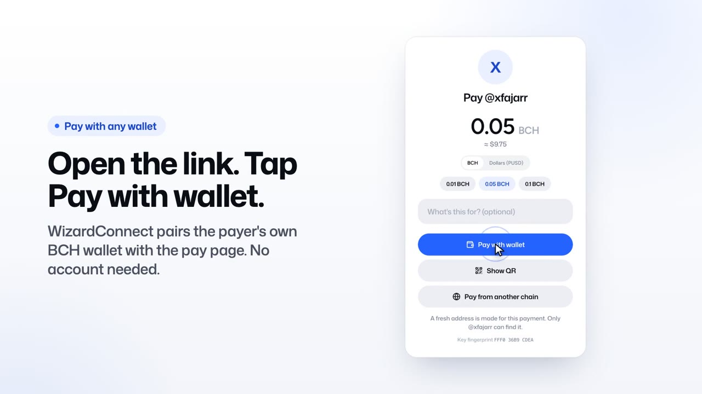</td>
    <td width="50%">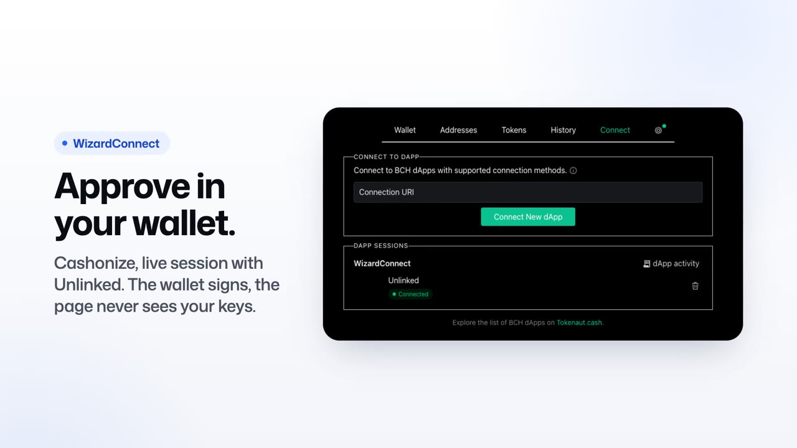</td>
  </tr>
  <tr>
    <td>The payer opens the link and taps Pay with wallet.</td>
    <td>Cashonize holds a live WizardConnect session. The wallet signs, the page never sees the payer's keys.</td>
  </tr>
  <tr>
    <td>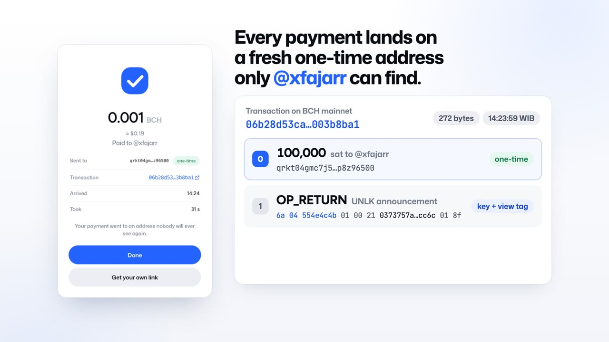</td>
    <td>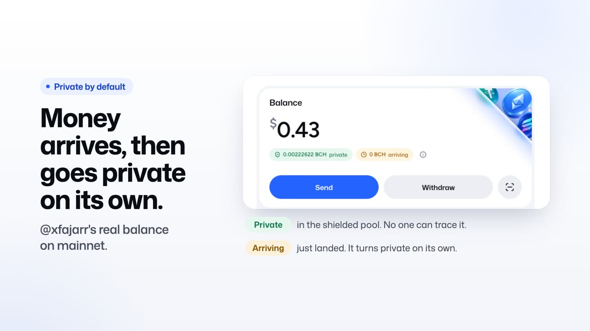</td>
  </tr>
  <tr>
    <td>Transaction 06b28d53: 100,000 sat to a one-time address, plus the UNLK announcement.</td>
    <td>The receiver's real balance. Private means it sits in the shielded pool.</td>
  </tr>
  <tr>
    <td>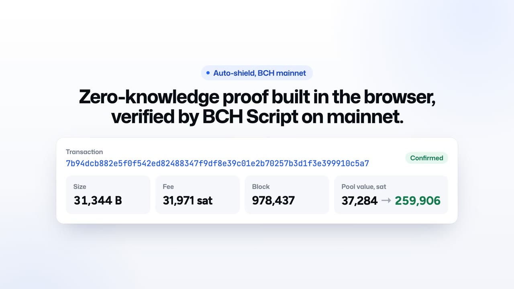</td>
    <td>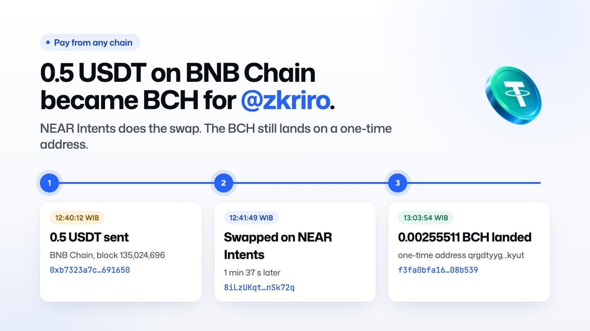</td>
  </tr>
  <tr>
    <td>The app shielded the payment on its own. BCH Script verified the proof on mainnet.</td>
    <td>0.5 USDT on BNB Chain arrived as BCH on a one-time address of @zkriro.</td>
  </tr>
  <tr>
    <td>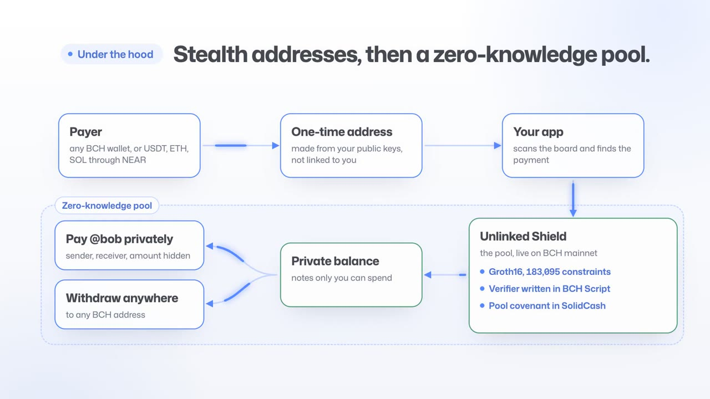</td>
    <td>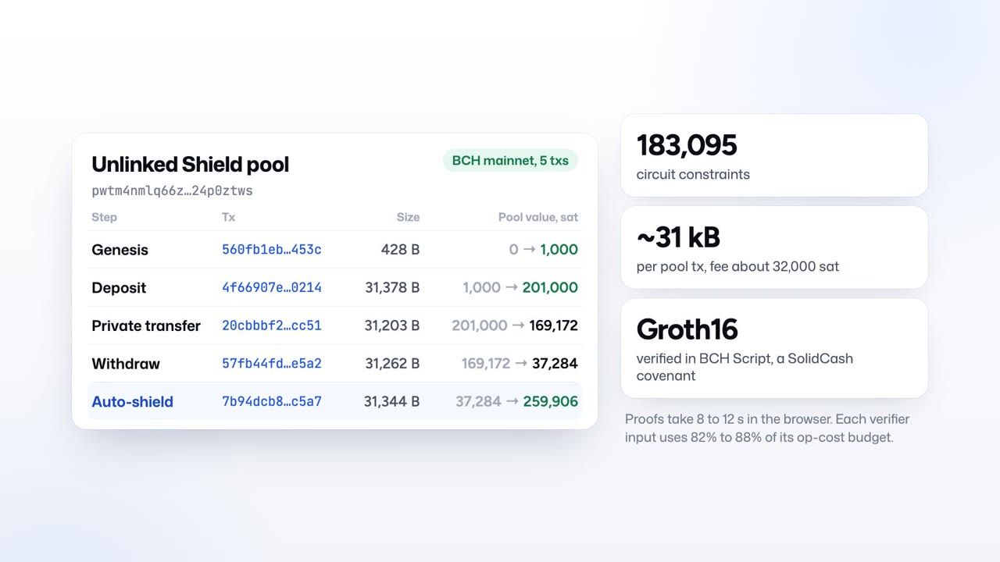</td>
  </tr>
  <tr>
    <td>Stealth addresses first, then the zero-knowledge pool.</td>
    <td>The pool's five mainnet transactions so far.</td>
  </tr>
</table>

## Unlinked Shield

Spec: `docs/2026-11-21-unlinked-shield-design.md`. Code: `shield/`.

The proof system is a Groth16 (BN254) 2-in-2-out join-split. Notes are Poseidon commitments in a depth-20 commitment tree, spent notes go into a depth-40 sparse Merkle tree of nullifiers, and the pool state `S = Poseidon(Rc, n, Rn)` lives in the commitment of the pool's mutable NFT.

| Part | Where | Details |
|---|---|---|
| Circuit | `shield/circuits/transact.circom` | 183,095 constraints. Public inputs are `[S_old, H]`, where `H` binds the new state, the commitments, the nullifiers, the public amount and the recipient data byte for byte. |
| Pool covenant | `shield/contracts/ShieldPool.scash` | Written in SolidCash. It checks the verifier statement, recreates the pool with the new state and enforces payout and fee. |
| Proof verifier | `shield/contracts/verifier/` | Groth16 verification in BCH Script, three verifier inputs per transaction, built from mr-zwets' `groth16_cashscript` (`chunked/bn254/bn-native-sound`). We added a 34-byte patch that binds the verifier coins to one pool (`shield/contracts/verifier/PATCH.md`). |
| Client | `src/lib/shield/` | Proofs are made in the browser in a Web Worker, in 12 to 23 s on a laptop (the first proof in a tab is the slowest). Incoming payments are shielded automatically. Sending to `@handle` and withdrawing both spend from the shielded balance. |
| Tests | `shield/contracts/test/solidhat/` | A SolidHat suite of 20 tests (`npm run test:solidhat`): genesis, deposit, transfer and withdraw with real proofs on SolidHat's mock network, plus 11 transactions rejected at the exact `require`. |

A pool transaction is about 31 kB, so the fee is about 32,000 sat. Each verifier input uses 82% to 88% of its standard op-cost budget.

## Live on BCH mainnet

BCHN mainnet nodes accepted the pool and its Groth16-verified transactions.

Pool: `bitcoincash:pwtm4nmlq66z9sxftgrjnanhku97ctyfxhrnccf0eqqalymceqhk624p0ztws`

| What happened | Transaction |
|---|---|
| Shield pool genesis | [`560fb1eb…526453c`](https://blockchair.com/bitcoin-cash/transaction/560fb1eb7318f0695ee2a7aa96d2d1ee973c7b0292743c07a973e0e88526453c) |
| Deposit of 200,000 sat, 31,378 B | [`4f66907e…9d50214`](https://blockchair.com/bitcoin-cash/transaction/4f66907e464bde42ba8a266cb0b4b82e3b76f20ab3d435fadad5a5e309d50214) |
| Private transfer, 31,203 B | [`20cbbbf2…faccc51`](https://blockchair.com/bitcoin-cash/transaction/20cbbbf2fd2479292831a60755196ef852c5f1df1ebc35e9aedc9f260faccc51) |
| Withdraw of 100,000 sat, 31,262 B | [`57fb44fd…97be5a2`](https://blockchair.com/bitcoin-cash/transaction/57fb44fd370bdc08f5532d176f7cb307bcc0165c51d279044e5844bd897be5a2) |
| Auto-shield from the app: 254,593 sat from a one-time address became a 222,622 sat private note | [`7b94dcb8…910c5a7`](https://blockchair.com/bitcoin-cash/transaction/7b94dcb882e5f0f542ed82488347f9df8e39c01e2b70257b3d1f3e399910c5a7) |
| WizardConnect: a Cashonize wallet paid `@xfajarr` 0.001 BCH | [`06b28d53…3b8ba1`](https://blockchair.com/bitcoin-cash/transaction/06b28d53caebd13bb26a1ee6ef6c6d9fcb5ca40598385387c94410b0003b8ba1) |
| Cross-chain, step 1: 0.5 USDT sent on BNB Chain | [`0xb7323a7c…691650`](https://bscscan.com/tx/0xb7323a7c215d4992fe1ad8d9cfe45c468c376935269130287c5a9e7d3a691650) |
| Cross-chain, step 2: NEAR Intents paid 255,511 sat to a one-time address of `@zkriro` | [`f3fa0bfa…08b539`](https://blockchair.com/bitcoin-cash/transaction/f3fa0bfa16623a8f4a8c9c23e7909481bb796b14ad2ec8b16de4a1ca7608b539) |

The WizardConnect transaction has one output to the one-time address, an `UNLK` OP_RETURN announcement with the ephemeral key, and the wallet's change.

## Trusted setup and known limits

- Phase 1 is the PSE perpetual powers of tau (`ppot_0080_18`).
- Phase 2 is a single contribution plus a random beacon (`shield/circuits/scripts/setup.sh`). That is fine for a demo and not for real value: a multi-party ceremony is required before the pool holds meaningful funds.
- The pool is new, so few notes sit in it today. The privacy a withdraw gets grows with the number of deposits.
- Deposit and withdraw amounts are public. Transfers inside the pool are not.

## SolidCash

The pool covenant is written in SolidCash and tested with SolidHat. While building it we opened [solidcash#19](https://github.com/solidcash/solidcash/pull/19) (a README fix for provider imports) and [solidcash#20](https://github.com/solidcash/solidcash/issues/20) (OP_DEFINE op-cost is under-counted in the pinned libauth).

## Repo layout

| Path | What |
|---|---|
| `src/` | The app: a Vite and React SPA. Screens are in `src/screens/`, the wallet, stealth and Shield client in `src/lib/`. |
| `api/` | The API: a Cloudflare Worker and D1. It holds profiles (public keys), the announcement board and a NEAR Intents proxy. |
| `shield/circuits/` | The circom circuit and the setup scripts. `build/` holds the verification key and the zkey hash. |
| `shield/contracts/` | The SolidCash pool, the verifier build and patch, VM test suites, and the deploy and end-to-end scripts. |
| `shield/contracts/test/solidhat/` | The SolidHat suite (`npm run test:solidhat`): the pool's genesis, deposit, transfer and withdraw with real proofs on SolidHat's mock network, plus 11 rejects at the exact `require`. |
| `shield/lib/`, `shield/tx/` | Witness generation, the trees and payload encoding (shared by the circuit tests and the app), and the browser transaction builder. |
| `shield/deployments/` | Deployed pool parameters per network. |
| `video/` | The Remotion source of the demo video. |

## Run locally

```sh
npm install && (cd api && npm install)
npm run dev:api        # API on :8790 with a local D1
npm run shield:assets  # prover files into public/shield (needs shield/circuits/build/transact_final.zkey)
npm run dev            # app on :3700 (mainnet); dev:chipnet for chipnet on :3702
```

Deploy with `npm run deploy:api`, then `npm run deploy` (Cloudflare Pages project `getunlinked`). `.env.production` holds `VITE_API_URL`.

## Credits

- The Groth16 verifier in BCH Script is mr-zwets/groth16_cashscript (verifier.cash), ISC.
- circom, snarkjs, circomlib and circomlibjs are by iden3, GPL-3.0.
- The powers of tau are PSE's perpetual powers of tau.
- The UI design is by zakariyyaaa.
